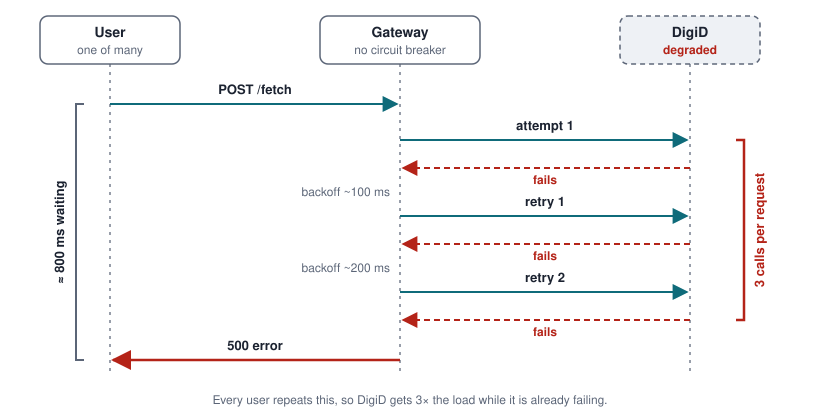
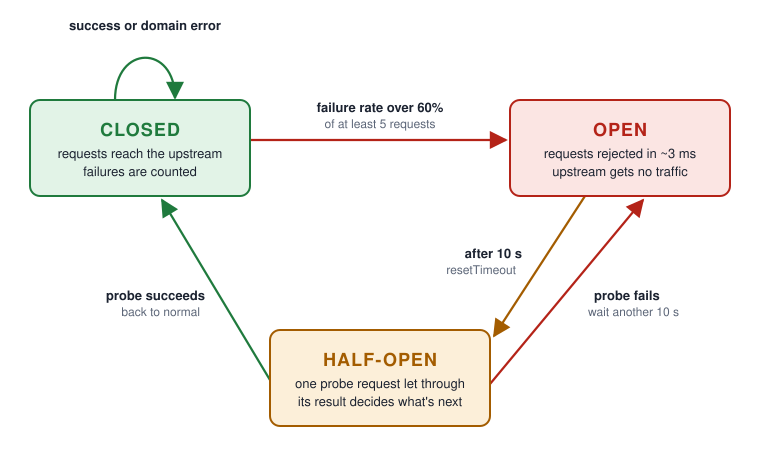
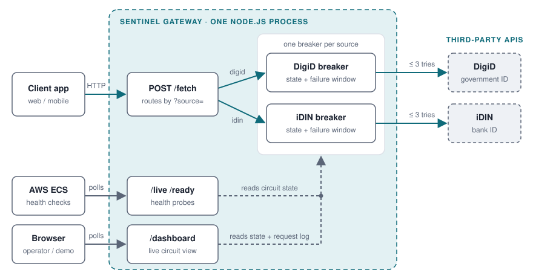
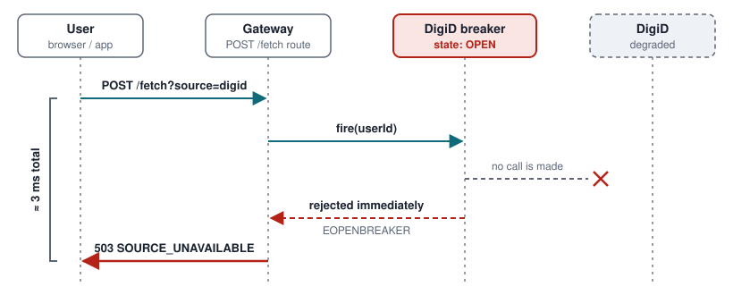

# Sentinel Gateway: Technical Write-up

A resilient API gateway that keeps a platform responsive when the third-party services it depends on slow down or fail.

`TypeScript 5.4 · Node.js 20` · `Express 4.19 · opossum 8.1` · `Jest · 23 tests`

**Contents**

1. [Summary](#1-summary)
2. [The problem](#2-the-problem)
3. [The solution: a circuit breaker](#3-the-solution-a-circuit-breaker)
4. [Architecture](#4-architecture)
5. [Implementation](#5-implementation)
6. [Measured results](#6-measured-results)
7. [Where to use it](#7-where-to-use-it)
8. [Limitations and next steps](#8-limitations-and-next-steps)

---

## 1. Summary

Sentinel Gateway sits between an application and the external data sources it needs. Every call to an external source goes through a **circuit breaker**. When a source starts failing, the breaker trips and the gateway stops calling it. Callers get an immediate, typed error instead of waiting through timeouts. When the source recovers, the gateway detects it and resumes traffic automatically.

The project uses two mock connectors modelled on Dutch identity services: **DigiD** (government identity) and **iDIN** (bank identity). It also exposes health endpoints designed for AWS ECS liveness and readiness probes, and a live dashboard that shows each circuit's state.

## 2. The problem

Financial platforms depend on APIs they don't control: identity providers, bank APIs under PSD2, credit bureaus, KYC services. These services have outages, maintenance windows and slow periods. The platform can't prevent that. It can only decide how to react.

### Why naive retries make outages worse

The common reaction to a failed call is to retry it. With one caller that is harmless. With thousands of users it becomes a **retry storm**:

- **Load multiplies.** With 2 retries, every user request becomes 3 calls to a service that is already struggling. Its recovery gets slower.
- **Users wait for nothing.** Each request waits through every attempt and every backoff delay before failing anyway. In this project that is about 800 ms per request.
- **Failures cascade.** Slow requests hold connections, threads and memory. The waiting spreads to callers that don't even use the failing source, and a single bad dependency can take down the whole platform.
- **Errors are ambiguous.** A generic `500` doesn't tell the caller whether to retry, ask the user for something, or show a "try again later" message.



*Without a circuit breaker, every request pays the full cost of a failure that is already known.*

### Two distinct kinds of failure

Not every error means a source is down. "User not found" or "consent revoked" is a correct answer from a healthy service. A system that treats these as outages will cut off healthy services because of ordinary user input. Telling the two apart is part of the problem.

## 3. The solution: a circuit breaker

The circuit breaker pattern, popularised by Michael Nygard's *Release It!*, wraps each external call in a small state machine. It tracks recent failures and decides whether a call should go through at all. The name comes from an electrical breaker: when it trips, it cuts the connection to protect the rest of the system.



*The three circuit states, what happens to requests in each, and what moves the circuit between them. Arrow colour matches the state it leads to.*

| State | Meaning | What happens to a request |
|---|---|---|
| **Closed** | Normal operation. The source is healthy. | Passes through to the source. Failures are counted in a rolling window. |
| **Open** | Tripped. Too many recent requests failed. | Rejected immediately with `503 SOURCE_UNAVAILABLE`. The source is not called. |
| **Half-open** | Testing whether the source has recovered. | The next request is let through as a probe. Its result decides the next state. |

Sentinel Gateway combines the breaker with three supporting ideas:

- **Typed errors.** Every failure maps to a specific error code and HTTP status, so callers can react correctly.
- **Error filtering.** Domain errors (user not found, consent revoked) never count toward tripping the circuit.
- **Separate health signals.** `/live` says the process is running. `/ready` says it can serve traffic. Each source has its own breaker, so one failing source degrades only the features that need it.

## 4. Architecture



*Solid arrows are the request path: one breaker per source, each guarding its own third-party API. Dashed arrows only read breaker state, so health probes and the dashboard never put load on DigiD or iDIN.*

| Path | Purpose |
|---|---|
| `src/circuit/breaker.ts` | Wraps opossum. Exposes `fire()` and `getState()`, filters domain errors and maps failures to typed errors. |
| `src/connectors/` | Shared `withRetry` helper and the DigiD and iDIN mocks, switchable between healthy, flaky and down. |
| `src/errors/types.ts` | `SourceUnavailable`, `UserNotFound` and `ConsentRevoked` error classes. |
| `src/routes/gateway.ts` | `POST /fetch`: picks the breaker, fires it and maps errors to HTTP responses. |
| `src/routes/health.ts` | `/live`, `/ready` and `/health` probes. |
| `src/routes/dashboard.ts` | Live dashboard page and its state endpoint. |

### Request flow when the circuit is open



*Compare with the retry storm in section 2: the same failure now costs milliseconds and puts no load on the source.*

## 5. Implementation

### Creating a breaker with an error filter

Each source gets its own breaker. The `errorFilter` tells opossum which errors should *not* count as failures. Domain errors are a valid answer from a healthy service, so they never trip the circuit.

```ts
// src/circuit/breaker.ts
const defaults: Required<BreakerOptions> = {
  errorThresholdPercentage: 60,  // trip above 60% failures
  volumeThreshold: 5,            // ...but only after 5 requests
  resetTimeout: 10_000,          // wait 10 s before probing
  timeout: 3_000,                // a call slower than 3 s counts as failed
};

function isDomainError(err: unknown): boolean {
  return err instanceof UserNotFound || err instanceof ConsentRevoked;
}

const breaker = new CircuitBreaker(fn, {
  ...config,
  // Domain errors are not infrastructure failures:
  // they must not count toward the failure rate.
  errorFilter: isDomainError,
});
```

### Mapping every failure to a typed error

The wrapper around `fire()` guarantees that callers never see a raw library error. A rejection from an open circuit and an upstream failure both become `SourceUnavailable`, with different messages.

```ts
// src/circuit/breaker.ts
async fire(...args: TArgs): Promise<TResult> {
  try {
    return await breaker.fire(...args);
  } catch (err) {
    // Domain errors pass through so the route can map them to 404 / 403.
    if (isDomainError(err)) throw err;
    // Circuit open: fail fast without touching the source.
    if (breaker.opened || (err as NodeJS.ErrnoException).code === 'EOPENBREAKER') {
      throw new SourceUnavailable(source, `${source} circuit is open — failing fast`);
    }
    // Retries exhausted or timed out: still typed, never a generic 500.
    throw new SourceUnavailable(source, `${source} is unavailable — upstream request failed`, {
      cause: err instanceof Error ? err.message : String(err),
    });
  }
}
```

### Retries with exponential backoff and jitter

Retries live inside the breaker, so they only happen while the circuit is closed. Only transient errors are retried. The delay doubles on each attempt (100 ms, then 200 ms), and up to 30% random jitter is added so that many clients don't retry in lockstep.

```ts
// src/connectors/base.ts
function jitter(base: number): number {
  return base + Math.random() * base * 0.3;
}

export async function withRetry<T>(
  fn: () => Promise<T>,
  maxRetries: number,
  isRetryable: (err: unknown) => boolean,
): Promise<T> {
  for (let attempt = 0; attempt <= maxRetries; attempt++) {
    try {
      return await fn();
    } catch (err) {
      if (!isRetryable(err) || attempt === maxRetries) throw err;
      const delay = jitter(100 * Math.pow(2, attempt));
      await new Promise((r) => setTimeout(r, delay));
    }
  }
}
```

### A typed error taxonomy

Each error class carries a stable code and its HTTP status. The route turns them into structured JSON, so callers can branch on `code` instead of parsing messages.

| Code | HTTP | Counts toward tripping? | What the caller should do |
|---|---|---|---|
| `SOURCE_UNAVAILABLE` | 503 | Yes | Show "try again later", use a fallback, or queue the work. |
| `USER_NOT_FOUND` | 404 | No | Ask the user to check their details. |
| `CONSENT_REVOKED` | 403 | No | Ask the user to grant consent again. |

Response when the circuit is open:

```json
{
  "code": "SOURCE_UNAVAILABLE",
  "message": "digid circuit is open — failing fast",
  "source": "digid",
  "timestamp": "2026-11-13T08:10:21.552Z"
}
```

### Liveness versus readiness

Container platforms such as AWS ECS and Kubernetes use two different health questions, and mixing them up is a common source of outages. `/live` answers "is the process running?" and always returns 200, so the platform never restarts a healthy process because a dependency is down. `/ready` answers "can this instance serve traffic?" and returns 503 only when *every* source is unavailable.

```ts
// src/routes/health.ts
router.get('/live', (_req, res) => {
  res.json({ status: 'ok' });   // process is alive; never depends on upstreams
});

router.get('/ready', (_req, res) => {
  const states = Object.values(breakers).map((b) => b.getState());
  const allOpen = states.every((s) => s === 'open');
  if (allOpen) {
    res.status(503).json({ status: 'degraded', message: 'all source connectors unavailable' });
  } else {
    res.json({ status: 'ok' });  // partial degradation still serves traffic
  }
});
```

## 6. Measured results

These numbers come from a full run of `demo.sh` against a local server. The mock sources add about 120 ms of simulated network latency per call.

| Request | Response time |
|---|---|
| Healthy call | 146 ms |
| Failing call, with retries | ~790 ms (747–815 ms) |
| Fast-fail, circuit open | **3 ms** |

| Phase | Observed behaviour |
|---|---|
| Domain errors | 6 consecutive `USER_NOT_FOUND` responses. The iDIN circuit stayed **closed**. |
| DigiD down | Requests 1–5 each returned `503 SOURCE_UNAVAILABLE` after retries. The circuit tripped to **open** on request 5. |
| Fast-fail | The next request returned in 3 ms, about 260× faster than a failing call, with no call to DigiD. |
| Isolation | iDIN kept answering in 160 ms and `/ready` stayed 200. |
| Recovery | After the 10 s reset timeout the circuit went **half-open**. One successful probe closed it, with no restart. |

### Test coverage

23 Jest tests across three suites cover the circuit state changes (trip, fast-fail without calling the source, half-open after the reset timeout, recovery), error codes and HTTP statuses, the end-to-end request flow, and the health probes. The test for "typed 503 instead of a generic 500" was written first and failed before the fix was made.

## 7. Where to use it

The pattern applies wherever a system calls a dependency over the network that can fail independently of the caller. Sentinel Gateway demonstrates it with identity checks, but the same design fits many domains:

| Domain | Dependencies to protect | Why a breaker helps |
|---|---|---|
| Fintech and lending | DigiD, iDIN, PSD2 bank APIs, credit bureaus, KYC and AML screening | Onboarding keeps working for the sources that are up, and users get a clear message instead of a hanging form. |
| Payments and e-commerce | Payment providers, fraud scoring, tax and shipping-rate APIs | Checkout can fall back to another provider or a cached rate instead of timing out. |
| Microservices | Internal services calling each other | Stops one slow service from exhausting connection pools across the whole system. |
| AI applications | LLM and embedding APIs with rate limits and outages | Fails fast to a fallback model or a queued job instead of stacking up slow requests. |
| Notifications | SMS, email and push providers | Switches to a backup provider or queues messages while the primary is down. |
| Healthcare and government | Record exchanges, eligibility checks, registries | Separates "no record found" from "registry unavailable", so staff take the right action. |

### When it is not the right tool

- **Background jobs that can wait.** A queue with retries and a dead-letter queue is usually simpler than a breaker.
- **Calls that must not be dropped.** A breaker rejects work. If every request must eventually succeed, pair it with a queue or an outbox.
- **Very low traffic.** With a few requests per minute, the rolling window rarely reaches the volume threshold, so the breaker seldom acts.

> **Related patterns.** Circuit breakers work best alongside timeouts, bulkheads (separate resource pools per dependency), fallbacks and rate limiting. The same idea is available as libraries in other ecosystems, such as Resilience4j for Java and Polly for .NET, and at the infrastructure level as outlier detection in service meshes like Envoy and Istio.

## 8. Limitations and next steps

### Current limitations

- **Breaker state is per process.** Each running instance has its own breakers. In a deployment with several ECS tasks, each one must discover an outage separately. Sharing state, for example through Redis, would make them trip together.
- **Retries can hide partial outages.** With 2 retries, a source that fails 70% of calls fails only about 34% of user requests, which stays under the 60% threshold. That is often the right trade-off, because users still get answers, but the source is under triple load. The threshold should be tuned against real traffic.
- **The sources are mocks.** They simulate latency and failures, but not real-world behaviour such as slow responses that hit the timeout, rate limiting or partial data.
- **Observability is in-memory.** The dashboard reads an in-process log of the last 50 requests, which suits a demo but not production.

### Next steps

- Export breaker state and request metrics to Prometheus or CloudWatch, with alerts on state changes.
- Add fallbacks per source, such as a cached result or a secondary provider.
- Add a per-source concurrency limit (bulkhead) alongside the breaker.
- Connect a real sandbox API and tune thresholds against measured error rates.
- Deploy to ECS with the `/live` and `/ready` probes wired into the task definition.
